<!-- ===================== HEADER ===================== -->

  

<h3 align="center">
  <code>Hey there! I'm <a href="https://www.linkedin.com/in/lao-thomorn-347a4b28b/">Lao Thomorn</a> 👋</code>
</h3>

  <code>[ Full-Stack Web Developer · UI/UX Designer · ICT Teacher — Siem Reap, Cambodia ]</code>

  

  
  
  

<!-- ===================== SYSTEM ACCESS ===================== -->

<table align="center">
  <tr>
    <td align="center"></td>
    <td align="center"></td>
    <td align="center"></td>
  </tr>
</table>

<!-- ===================== TECH ARSENAL ===================== -->

<table align="center">
  <tr>
    <td align="right"><code>frontend</code></td>
    <td></td>
  </tr>
  <tr>
    <td align="right"><code>backend</code></td>
    <td></td>
  </tr>
  <tr>
    <td align="right"><code>data</code></td>
    <td></td>
  </tr>
  <tr>
    <td align="right"><code>design</code></td>
    <td></td>
  </tr>
  <tr>
    <td align="right"><code>tools</code></td>
    <td></td>
  </tr>
  <tr>
    <td align="right"><code>deploy</code></td>
    <td></td>
  </tr>
</table>

<!-- ===================== VITAL STATISTICS ===================== -->

  

  

  

<!-- ===================== OPEN CHANNELS ===================== -->

**🤝 I'd love to collaborate on:**

- 🌐 Full-stack web apps with React, Node.js, Laravel or FastAPI
- 🎨 UI/UX design, from wireframes to interactive Figma prototypes
- 🎓 EdTech and digital-skills tools for young people in Cambodia
- 🔐 Web security and beginner-friendly cybersecurity projects

**📡 Reach me:**

- 🖥️ Website: [myportfolio-7s0.pages.dev](https://myportfolio-7s0.pages.dev/)
- ✉️ Email: [laothomorn@gmail.com](mailto:laothomorn@gmail.com)
- 💼 LinkedIn: [Lao Thomorn](https://www.linkedin.com/in/lao-thomorn-347a4b28b/)
- 🎨 Figma: [@CyberMorn](https://www.figma.com/@CyberMorn)
- 🐦 X: [@cybermorn](https://x.com/cybermorn)

<!-- ===================== FOOTER ===================== -->

  <code>Blending creativity with code — one pixel and one commit at a time.</code>
    
  If something here helped you, leave a ⭐ on the repo. 🥷🏻

  

